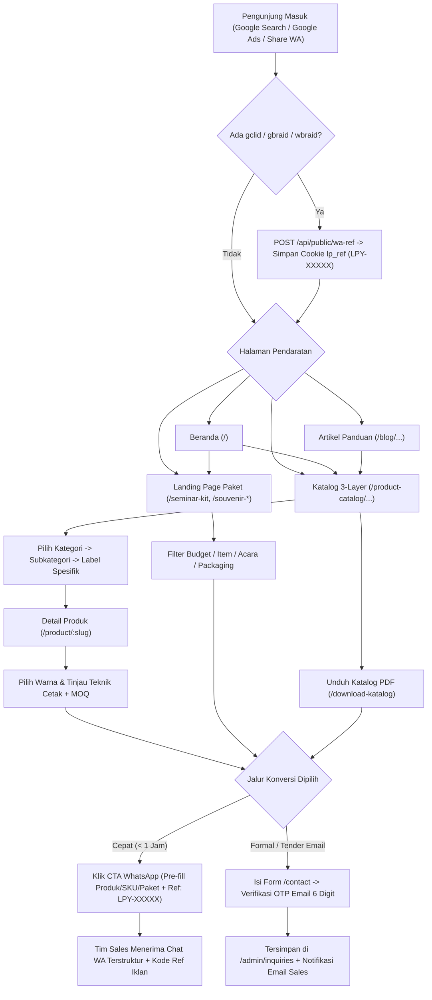
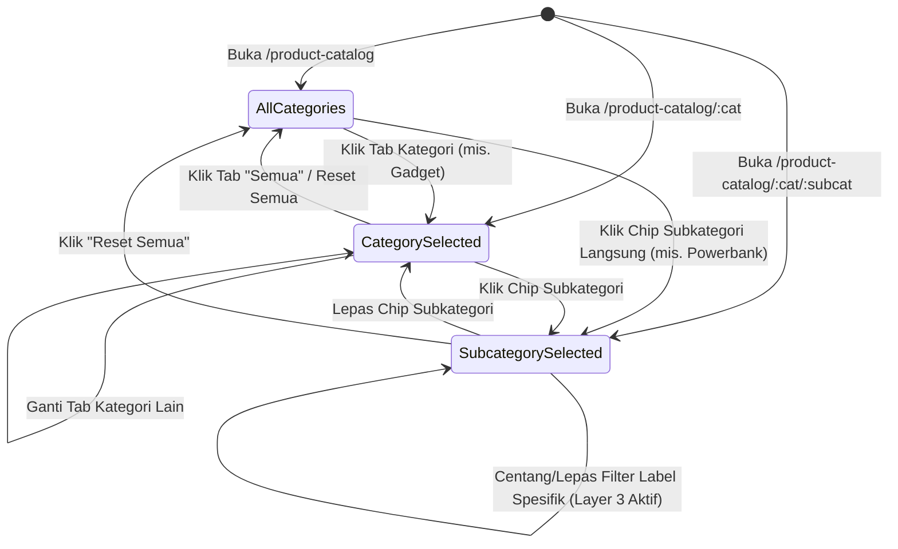
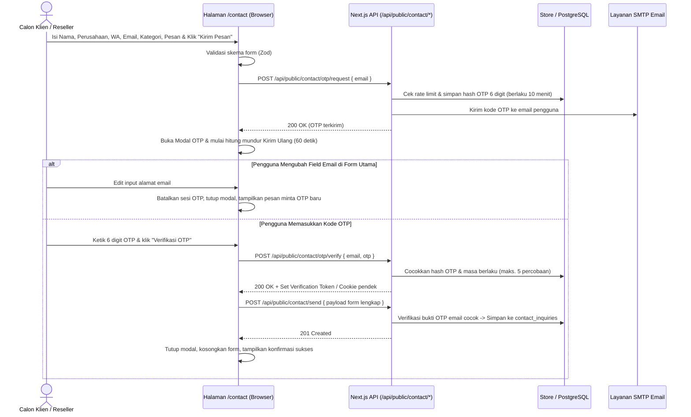
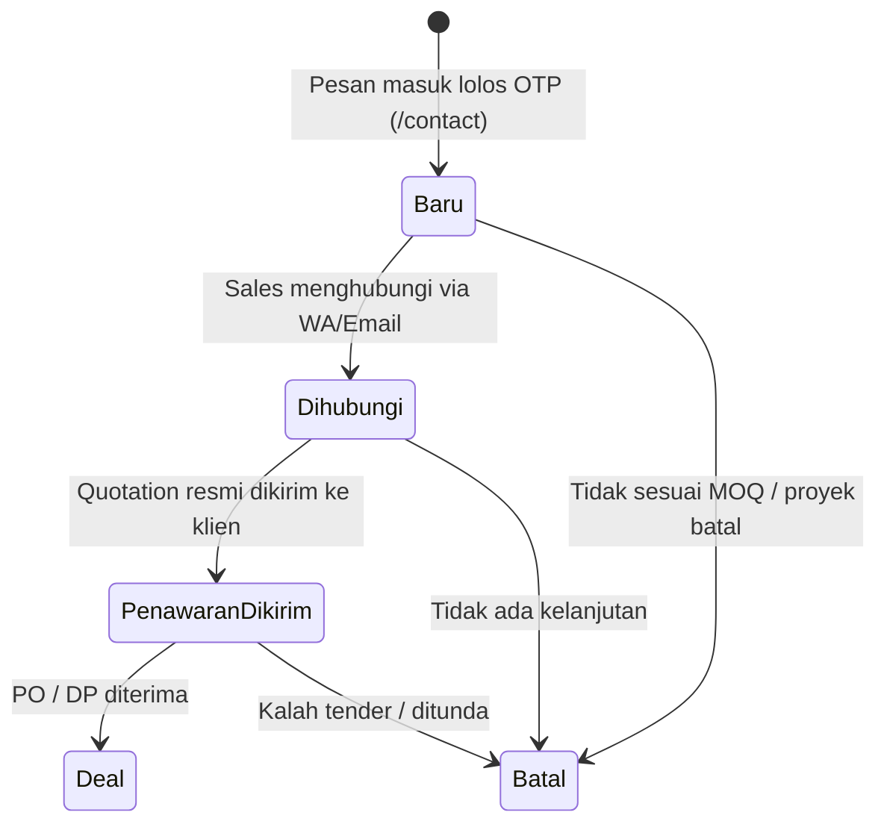

# Arsitektur Informasi, Sitemap & Alur Aplikasi — Liebe Pyrus B2B

**Versi Dokumen:** 1.0
**Tanggal:** 25 November 2026
**Mengacu ke:** [01-PRD.md](01-PRD.md)

Dokumen ini memetakan seluruh struktur URL halaman publik maupun panel admin, alur konversi pengguna B2B, *state machine* katalog 3-lapis, sekuens verifikasi OTP email, serta mekanisme atribusi iklan offline ke WhatsApp.

---

## 1. Peta Situs & Struktur Rute Lengkap (*URL Sitemap*)

### 1.1 Rute Halaman Publik (SSR / SEO-Indexed)

| Rute URL | Nama Halaman | Prioritas Sitemap | Frekuensi Update | Kebutuhan Terkait |
| --- | --- | --- | --- | --- |
| `/` | Beranda Utama (*Homepage*) | `1.0` | `monthly` | `HOM-01` s/d `HOM-06` |
| `/product-catalog` | Katalog Produk Utama (Semua Kategori) | `0.9` | `weekly` | `CAT-01` s/d `CAT-05` |
| `/product-catalog/[categorySlug]` | Katalog per Kategori (`gadget`, `payung`, `stationery`, `tumbler`) | `0.8` | `weekly` | `CAT-01`, `CAT-02` |
| `/product-catalog/[categorySlug]/[subcategorySlug]` | Katalog per Subkategori + Filter Label Aktif (mis. `/product-catalog/gadget/powerbank`) | `0.7` | `weekly` | `CAT-01` s/d `CAT-05` |
| `/product/[slug]` | Halaman Detail Produk (PDP, mis. `/product/powerbank-10000mah-slim-abs-lp-pb100-01`) | `0.7` | `weekly` | `PDP-01` s/d `PDP-03` |
| `/seminar-kit` | Interactive Seminar Kit Finder & Paket Acara | `0.8` | `monthly` | `KIT-01`, `KIT-02` |
| `/souvenir-kantor-premium` | Pillar Landing Page: Souvenir Kantor & Onboarding Kit | `0.8` | `monthly` | `LND-01` |
| `/souvenir-payung` | Pillar Landing Page: Souvenir Payung Custom Logo | `0.8` | `monthly` | `LND-01` |
| `/souvenir-notebook-custom` | Pillar Landing Page: Souvenir Notebook & Agenda Custom | `0.8` | `monthly` | `LND-01` |
| `/powerbank-custom` | Pillar Landing Page: Souvenir Powerbank Custom Logo | `0.8` | `monthly` | `LND-01` |
| `/logo-details` | Layanan Cetak Logo In-House (6 Mesin & Teknik) | `0.7` | `monthly` | `SRV-01` |
| `/custom-design` | Layanan Persiapan Artwork & Digital Mockup Gratis | `0.7` | `monthly` | `SRV-02` |
| `/kualitas` | Standar Kualitas, Uji Lab SUS 304 & Garansi 1 Tahun | `0.7` | `monthly` | `SRV-03` |
| `/pengiriman` | Layanan Pengemasan (`#pengemasan`), Pengiriman (`#pengiriman`) & Blind Dropship | `0.7` | `monthly` | `SRV-04` |
| `/download-katalog` | Pusat Unduh Katalog PDF Perusahaan | `0.6` | `monthly` | `SRV-05` |
| `/portfolio` | Portofolio Hasil Produksi Klien Korporat per Industri | `0.7` | `monthly` | `SRV-06` |
| `/about-us` | Tentang Liebe Pyrus, Filosofi Brand & Fasilitas | `0.6` | `monthly` | `SRV-06` |
| `/contact` | Hubungi Kami & Form Konsultasi B2B Berverifikasi OTP | `0.6` | `monthly` | `RFQ-01` |
| `/faq` | Pusat Tanya Jawab Pengadaan Merchandise B2B | `0.6` | `monthly` | `BLG-01` |
| `/blog` | Indeks Artikel & Panduan Souvenir Perusahaan | `0.7` | `weekly` | `BLG-01` |
| `/blog/[slug]` | Halaman Baca Artikel Edukasi B2B | `0.6` | `monthly` | `BLG-01` |
| `/privacy` | Kebijakan Privasi Data Klien & Prospek | `0.3` | `yearly` | `BLG-01` |
| `/legal` | Syarat & Ketentuan Pemesanan & Garansi (`#terms`) | `0.3` | `yearly` | `BLG-01` |

### 1.2 Rute Backoffice Admin CMS (`robots: noindex, nofollow`)

| Rute URL | Fungsi Halaman |
| --- | --- |
| `/admin/login` | Halaman masuk Admin & Tim Sales |
| `/admin` | Ringkasan metrik katalog, *leads* baru, dan klik atribusi WA |
| `/admin/categories` | Kelola Kategori, Subkategori, dan Label Filter Spesifik |
| `/admin/products` | Daftar produk, pencarian SKU, tambah & sunting produk |
| `/admin/seminar-kits` | Kelola paket Seminar Kit & parameter filter 4 dimensi |
| `/admin/portfolio` | Kelola kartu proyek portofolio per industri |
| `/admin/catalogs` | Unggah & atur urutan Katalog PDF beserta sampulnya |
| `/admin/blog` | Editor artikel panduan B2B & metadata SEO/GEO |
| `/admin/faqs` | Kelola daftar tanya jawab per kategori topik |
| `/admin/inquiries` | Kotak masuk pesan form kontak (tindak lanjut status *leads*) |
| `/admin/wa-refs` | Tabel pencocokan kode `LPY-XXXXX` ↔ klik iklan Google Ads + Ekspor CSV |
| `/admin/settings` | Konfigurasi nomor WhatsApp utama, email, alamat, dan sapaan WA |

---

## 2. Alur Konversi Utama Pengunjung B2B (*Visitor-to-Lead Funnel*)

---

## 3. State Machine Filter Katalog 3-Layer (`CAT-01` s/d `CAT-05`)

Katalog produk memadukan **kemudahan ramban URL bertingkat** (untuk SEO & *bookmark*) dengan **filter faset teknis mendalam** yang hanya relevan ketika pengguna sudah mengerucut ke satu subkategori.

### Aturan Perilaku Katalog 3-Layer:
1. **Saat berada di `AllCategories` (`/product-catalog`):**
   - Tab `Semua` aktif.
   - Layer 2 menampilkan seluruh grup subkategori yang dikelompokkan berdasarkan nama kategori induknya (`Gadget`, `Payung`, `Stationery`, `Tumbler`).
   - Layer 3 berada dalam kondisi terkunci (`aria-disabled="true"`) dengan keterangan *"Pilih sub kategori untuk memunculkan filter spesifik"*.
2. **Saat berada di `CategorySelected` (`/product-catalog/gadget`):**
   - Tab `Gadget` aktif; URL disinkronkan ke `/product-catalog/gadget`.
   - Layer 2 hanya menampilkan chip subkategori milik `Gadget` (*Powerbank, TWS Earphone, USB Flashdrive, Wireless Charger, Wireless Mouse, Travel Adapter, Digital Clock, Bluetooth Speaker*).
   - Daftar produk difilter ke seluruh item dalam kategori `Gadget`.
3. **Saat berada di `SubcategorySelected` (`/product-catalog/gadget/powerbank`):**
   - Tab induk `Gadget` dan chip `Powerbank` sama-sama menyala aktif; URL menjadi `/product-catalog/gadget/powerbank`.
   - Sistem memuat daftar atribut filter spesifik `Powerbank` dari cache atau `GET /api/public/catalog/labels?subcategoryId=...` (mis. *Kapasitas: 5.000 mAh, 10.000 mAh, 20.000 mAh*; *Fitur: Wireless, Kabel Terintegrasi*; *Material: ABS, Metal*).
   - Layer 3 terbuka penuh; setiap pemilihan nilai label memperbarui query parameter (`?labels=12,15&page=1`), menampilkan chip di **Filter Aktif**, dan mereset paginasi ke halaman `1`.

---

## 4. Sekuens Verifikasi OTP Email pada Formulir Kontak (`RFQ-01`)

Untuk memastikan tim sales hanya menerima permintaan penawaran dari alamat email perusahaan/pemesan yang valid dan bebas dari banjir bot spam, pengiriman pesan wajib melewati alur dua langkah berikut:

---

## 5. Alur Atribusi Konversi Iklan ke WhatsApp (`WA-01`, `WA-02`)

```mermaid
flowchart LR
    AdClick["Klik Google Ads (?gclid=EAIaIQ...&utm_campaign=payung-b2b)"] --> Landing["Mendarat di /souvenir-payung"]
    Landing --> Tracker["Client Script mendeteksi gclid"]
    Tracker --> PostRef["POST /api/public/wa-ref (gclid, utm_*, landing_path)"]
    PostRef --> GenCode["Server simpan ke wa_ad_refs & buat kode unik LPY-K8M4P"]
    GenCode --> Cookie["Set Cookie lp_ref=LPY-K8M4P (90 hari, Last-Click Wins)"]
    Cookie --> RewriteWA["Semua link wa.me otomatis disisipi sapaan halaman + (Ref: LPY-K8M4P)"]
    RewriteWA --> ChatSales["Klien kirim chat WA ke Sales Liebe Pyrus"]
    ChatSales --> Reconcile["Admin cocokkan LPY-K8M4P di /admin/wa-refs & ekspor CSV Offline Conversion"]
```

### Ketentuan Teknis Atribusi WhatsApp:
- **Pola Kode Referensi:** `^LPY-[23456789ABCDEFGHJKLMNPQRSTUVWXYZ]{5}$` (menghindari huruf/angka yang mirip secara visual seperti `0`/`O` dan `1`/`I` agar mudah dibaca atau diketik ulang oleh tim sales bila perlu).
- **Aturan *Last-Click Wins*:** Apabila pengunjung yang sudah memiliki cookie `lp_ref` datang kembali melalui klik iklan baru yang membawa `gclid`/`gbraid`/`wbraid` baru, sistem memperbarui rekaman dan mengganti cookie `lp_ref` ke kode terbaru.
- **Pengunjung Organik:** Apabila pengunjung datang dari pencarian organik tanpa parameter klik iklan dan belum memiliki cookie `lp_ref`, tautan WhatsApp tetap memakai sapaan kontekstual bersih tanpa embel-embel `(Ref: ...)`.

---

## 6. Alur Operasional Admin CMS & Tindak Lanjut Leads (`CMS-01` s/d `CMS-06`)

Seluruh aksi perubahan produk, kategori, maupun status *inquiry* di dalam `/admin` diverifikasi melalui sesi pengguna aktif di sisi server dan dicatat ke dalam `audit_logs` (waktu, pelaku, jenis entitas, ID entitas, dan ringkasan perubahan).
