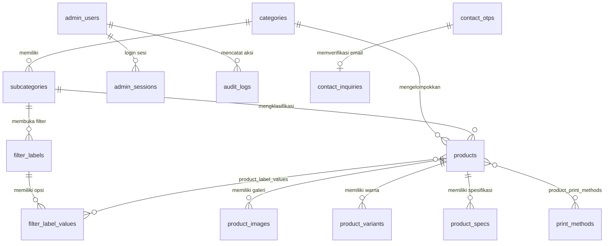

# Model Data Database, Konvensi SKU & Kontrak API — Liebe Pyrus B2B

**Versi Dokumen:** 1.0
**Tanggal:** 25 November 2026
**Mengacu ke:** [01-PRD.md](01-PRD.md), [03-TECH-STACK-AND-ARCHITECTURE.md](03-TECH-STACK-AND-ARCHITECTURE.md)

Dokumen ini mendefinisikan skema lengkap database PostgreSQL, aturan penomoran kode SKU produk **Liebe Pyrus**, cetak biru *seed data* awal, serta spesifikasi kontrak REST API publik dan admin.

---

## 1. Entity-Relationship Diagram (ERD)



---

## 2. Definisi Tabel PostgreSQL (19 Tabel Inti)

### 2.1 Domain Katalog & Filter 3-Layer

1. **`categories`**
   - `id` (`serial`, PK), `name` (`varchar(80)`), `slug` (`varchar(80)`, unique), `description` (`text`), `hero_image_url` (`text`), `popular_tags` (`jsonb` string[]), `sort_order` (`int`), `is_active` (`boolean`, default `true`), `created_at`, `updated_at`.
2. **`subcategories`**
   - `id` (`serial`, PK), `category_id` (`int`, FK → `categories.id`), `name` (`varchar(100)`), `slug` (`varchar(100)`), `description` (`text`), `sort_order` (`int`), `is_active` (`boolean`, default `true`), unique(`category_id`, `slug`).
3. **`filter_labels`** *(Grup atribut Layer 3 per subkategori, mis. "Kapasitas", "Material", "Fitur")*
   - `id` (`serial`, PK), `subcategory_id` (`int`, FK → `subcategories.id`), `name` (`varchar(80)`), `slug` (`varchar(80)`), `sort_order` (`int`).
4. **`filter_label_values`** *(Pilihan nilai pada grup atribut, mis. "10.000 mAh", "SUS 304", "Wireless Charging")*
   - `id` (`serial`, PK), `filter_label_id` (`int`, FK → `filter_labels.id`), `value` (`varchar(100)`), `slug` (`varchar(100)`), `sort_order` (`int`).
5. **`print_methods`** *(Master 6 teknik cetak logo in-house)*
   - `id` (`serial`, PK), `code` (`varchar(40)`, unique: `uv_printing`, `laser_engraving`, `hot_stamping`, `sablon`, `dtf_uv`, `laser_3d`), `name` (`varchar(80)`), `short_label` (`varchar(40)`), `best_for` (`text`), `suitable_products` (`text`), `machine_name` (`varchar(120)`), `sort_order` (`int`).
6. **`products`**
   - `id` (`serial`, PK), `sku` (`varchar(40)`, unique, wajib awalan `LP-`), `name` (`varchar(180)`), `slug` (`varchar(200)`, unique), `category_id` (`int`, FK), `subcategory_id` (`int`, FK), `short_description` (`text`), `full_description` (`text`), `moq` (`int`, default `50`), `logo_area` (`varchar(80)`), `warranty_months` (`int`, default `0`), `badge` (`varchar(20)`, nullable: `'unggulan' | 'baru' | null`), `is_featured` (`boolean`, default `false`), `featured_order` (`int`), `is_active` (`boolean`, default `true`), `seo_title` (`varchar(180)`), `seo_description` (`varchar(320)`), `created_at`, `updated_at`.
7. **`product_images`**
   - `id` (`serial`, PK), `product_id` (`int`, FK → `products.id` ON DELETE CASCADE), `image_url` (`text`), `alt_text` (`varchar(200)`), `color_code` (`varchar(40)`, nullable untuk ikat ke warna tertentu), `is_primary` (`boolean`), `sort_order` (`int`).
8. **`product_variants`** *(Pilihan warna produk)*
   - `id` (`serial`, PK), `product_id` (`int`, FK → `products.id` ON DELETE CASCADE), `color_name` (`varchar(60)`), `color_hex` (`varchar(7)`), `is_available` (`boolean`, default `true`), `sort_order` (`int`).
9. **`product_print_methods`** *(Relasi many-to-many produk ↔ teknik cetak + catatan/contoh spesifik)*
   - `product_id` (`int`, FK), `print_method_id` (`int`, FK), `sample_note` (`text`), `sample_image_url` (`text`, nullable), PK(`product_id`, `print_method_id`).
10. **`product_label_values`** *(Relasi many-to-many produk ↔ nilai filter Layer 3)*
    - `product_id` (`int`, FK), `filter_label_value_id` (`int`, FK), PK(`product_id`, `filter_label_value_id`).
11. **`product_specs`** *(Baris tabel spesifikasi terstruktur pada PDP)*
    - `id` (`serial`, PK), `product_id` (`int`, FK → `products.id` ON DELETE CASCADE), `spec_label` (`varchar(80)`), `spec_value` (`varchar(200)`), `sort_order` (`int`).

### 2.2 Domain Paket Kurasi, Konten Korporat & Katalog PDF

12. **`seminar_kits`**
    - `id` (`serial`, PK), `name` (`varchar(140)`), `slug` (`varchar(160)`, unique), `budget_tier` (`varchar(40)`: `lt_50k`, `50k_100k`, `100k_200k`, `200k_400k`, `gt_400k`), `budget_label` (`varchar(60)`), `item_count` (`int`), `event_types` (`jsonb` string[]), `packaging_type` (`varchar(60)`: `Paper Bag`, `Tote Bag`, `Map Folder`, `Gift Box`), `items_included` (`jsonb` string[]), `description` (`text`), `image_url` (`text`), `sort_order` (`int`), `is_active` (`boolean`).
13. **`portfolio_items`**
    - `id` (`serial`, PK), `title` (`varchar(160)`), `category_slug` (`varchar(60)`), `industry` (`varchar(80)`), `client_name` (`varchar(120)`), `print_technique` (`varchar(80)`), `image_url` (`text`), `show_on_homepage` (`boolean`, default `false`), `homepage_order` (`int`), `sort_order` (`int`), `is_active` (`boolean`).
14. **`catalog_pdfs`**
    - `id` (`serial`, PK), `catalog_name` (`varchar(160)`), `description` (`text`), `thumbnail_url` (`text`), `pdf_url` (`text`), `file_size_label` (`varchar(40)`), `sort_order` (`int`), `is_active` (`boolean`), `updated_at`.
15. **`blog_posts`**
    - `id` (`serial`, PK), `title` (`varchar(200)`), `slug` (`varchar(220)`, unique), `excerpt` (`text`), `content_markdown` (`text`), `cover_image_url` (`text`), `category_tag` (`varchar(60)`), `author_name` (`varchar(100)`), `published_at` (`timestamptz`), `is_published` (`boolean`), `seo_title` (`varchar(200)`), `seo_description` (`varchar(320)`), `updated_at`.
16. **`faqs`**
    - `id` (`serial`, PK), `topic_group` (`varchar(80)`: `Pemesanan & MOQ`, `Layanan Cetak Logo`, `Custom Design`, `Kualitas & Garansi`, `Pengiriman & Dropship`, `Souvenir Payung Custom`), `question` (`text`), `answer` (`text`), `show_on_logo_page` (`boolean`, default `false`), `sort_order` (`int`), `is_active` (`boolean`).

### 2.3 Domain Konversi Leads, Atribusi Iklan & Admin

17. **`contact_otps`**
    - `id` (`serial`, PK), `email` (`varchar(180)`), `otp_hash` (`varchar(128)`), `verification_token_hash` (`varchar(128)`, nullable), `attempts` (`int`, default `0`), `expires_at` (`timestamptz`), `verified_at` (`timestamptz`, nullable), `requester_ip` (`varchar(64)`), `created_at`.
18. **`contact_inquiries`**
    - `id` (`serial`, PK), `full_name` (`varchar(120)`), `company_name` (`varchar(160)`), `phone` (`varchar(40)`), `email` (`varchar(180)`), `interest` (`varchar(80)`), `message` (`text`), `wa_ref_code` (`varchar(16)`, nullable), `status` (`varchar(30)`, default `'baru'`: `baru`, `dihubungi`, `penawaran_dikirim`, `deal`, `batal`), `sales_notes` (`text`), `created_at`, `updated_at`.
19. **`wa_ad_refs`** + **`site_settings`** + **`admin_users`** / **`admin_sessions`** / **`audit_logs`**
    - `wa_ad_refs`: `id` (`serial`, PK), `ref_code` (`varchar(12)`, unique, mis. `LPY-A7K2Q`), `gclid` (`text`, nullable), `gbraid` (`text`, nullable), `wbraid` (`text`, nullable), `utm_source` (`varchar(120)`), `utm_medium` (`varchar(120)`), `utm_campaign` (`varchar(180)`), `landing_path` (`varchar(255)`), `user_agent` (`text`), `created_at`.
    - `site_settings`: pasangan `key` (`varchar(80)`, PK) & `value` (`jsonb`) untuk menyimpan nomor WA aktif, telepon, email, alamat kantor, jam kerja, dan template sapaan WA.
    - `admin_users`, `admin_sessions`, dan `audit_logs`: mendukung autentikasi sesi `HttpOnly` dan jejak audit setiap perubahan data di CMS.

---

## 3. Standar Penomoran Kode SKU Produk (`LP-*`)

Seluruh produk **Liebe Pyrus** menggunakan format kode SKU bersih yang mudah dibaca oleh klien maupun tim produksi:

| Kategori | Subkategori | Pola Kode SKU | Contoh Kode SKU | Contoh Nama Produk |
| --- | --- | --- | --- | --- |
| **Gadget** | Powerbank | `LP-PB<Kapasitas>-<Urut>` | `LP-PB100-01` | Powerbank 10.000mAh Slim ABS Custom Logo |
| **Gadget** | Powerbank Wireless | `LP-PW<Kapasitas>-<Urut>` | `LP-PW050-01` | Powerbank Wireless Magnetik 5.000mAh Lanyard |
| **Gadget** | TWS Earphone | `LP-TWS-<Urut>` | `LP-TWS-02` | TWS Earphone Bluetooth 5.3 Touch Control |
| **Gadget** | USB Flashdrive | `LP-FD<Material>-<Urut>` | `LP-FDWD-02` | USB Flash Drive Kayu Oval Laser Engraving |
| **Gadget** | Charging / Adapter | `LP-CHG-<Urut>` | `LP-CHG-04` | Charging Station Lipat 4-in-1 Fast Charge 22.5W |
| **Stationery** | Notebook | `LP-NBK-<Urut>` | `LP-NBK-01` | Notebook Hardcover PU Leather A5 Strap Elastis |
| **Stationery** | Agenda | `LP-AGD-<Urut>` | `LP-AGD-06` | Agenda Binder 6-Lubang Hardcover PU Klip Magnet |
| **Stationery** | Pen | `LP-PEN-<Urut>` | `LP-PEN-01` | Pulpen Metal Eksekutif Klip Chrome |
| **Stationery** | Giftbox Set | `LP-GFB-<Urut>` | `LP-GFB-01` | Executive Corporate Gift Set 3-in-1 Hardbox |
| **Tumbler** | Vacuum Tumbler | `LP-TMB304-<Urut>` | `LP-TMB304-01` | Vacuum Flask Stainless Steel SUS 304 500ml Zenith |
| **Tumbler** | Coffee Cup | `LP-CUP304-<Urut>` | `LP-CUP304-02` | Insulated Coffee Mug SUS 304 350ml Anti-Tumpah |
| **Payung** | Payung Lipat 3 | `LP-UML3-<Urut>` | `LP-UML3-01` | Payung Lipat 3 Otomatis Anti-UV Black Coating |
| **Payung** | Payung Golf | `LP-UMGF-<Urut>` | `LP-UMGF-01` | Payung Golf Double Layer Fiber Windproof 30 Inch |
| **Payung** | Payung Kapsul | `LP-UMKP-<Urut>` | `LP-UMKP-01` | Payung Kapsul Mini 5-Lipat UPF 50+ Case Eksklusif |

---

## 4. Kontrak REST API Publik (`/api/public/*`)

### 4.1 Katalog & Filter Dinamis

- **`GET /api/public/catalog/taxonomy`**
  - Mengembalikan daftar `categories`, `subcategoryGroups` (dikelompokkan per `category_id`), dan daftar `printMethods`.
- **`GET /api/public/catalog/labels?subcategoryId=12`**
  - Mengembalikan grup atribut filter Layer 3 khusus subkategori tersebut:
    ```json
    {
      "subcategoryId": 12,
      "groups": [
        {
          "id": 1,
          "name": "Kapasitas Baterai",
          "values": [
            { "id": 101, "value": "5.000 mAh", "slug": "5000-mah" },
            { "id": 102, "value": "10.000 mAh", "slug": "10000-mah" }
          ]
        }
      ]
    }
    ```
- **`GET /api/public/catalog/products?categorySlug=gadget&subcategorySlug=powerbank&labels=102&q=&page=1&pageSize=16`**
  - Mengembalikan produk terfilter dengan paginasi:
    ```json
    {
      "items": [
        {
          "id": 1,
          "sku": "LP-PB100-01",
          "name": "Powerbank 10.000mAh Desain Simpel ABS",
          "slug": "powerbank-10000mah-desain-simpel-abs-lp-pb100-01",
          "categoryName": "Gadget",
          "subcategoryName": "Powerbank",
          "moq": 50,
          "badge": "unggulan",
          "primaryImageUrl": "/images/products/lp-pb100-01-black.webp",
          "printMethods": ["Grafir Laser", "Sablon", "UV Digital Printing"]
        }
      ],
      "totalItems": 1,
      "page": 1,
      "pageSize": 16,
      "totalPages": 1
    }
    ```

### 4.2 Katalog PDF

- **`GET /api/public/catalog-pdfs`**
  - Respons `200 OK`:
    ```json
    {
      "items": [
        {
          "id": 1,
          "catalog_name": "Katalog Lengkap Souvenir & Merchandise Liebe Pyrus 2026",
          "description": "Edisi lengkap Gadget, Tumbler SUS 304, Stationery & Payung Custom",
          "thumbnail_url": "/images/catalogs/cover-all-2026.webp",
          "pdf_url": "/files/katalog-liebe-pyrus-2026.pdf",
          "file_size_label": "8.4 MB"
        }
      ]
    }
    ```

### 4.3 Verifikasi OTP Email & Pengiriman Formulir Kontak

- **`POST /api/public/contact/otp/request`**
  - Body: `{ "email": "procurement@perusahaan.co.id" }`
  - Respons `200 OK`: `{ "ok": true, "cooldownSeconds": 60, "expiresInSeconds": 600 }`
  - Respons `429 Too Many Requests`: `{ "error": "Mohon tunggu sebelum meminta kode OTP baru." }`
- **`POST /api/public/contact/otp/verify`**
  - Body: `{ "email": "procurement@perusahaan.co.id", "otp": "482910" }`
  - Respons `200 OK`: menyetel cookie pendek `lp_contact_verified` (`HttpOnly`, 15 menit, terikat ke email) + `{ "ok": true }`
  - Respons `400 Bad Request`: `{ "error": "Kode OTP tidak sesuai atau telah kedaluwarsa." }`
- **`POST /api/public/contact/send`**
  - Body:
    ```json
    {
      "fullName": "Budi Santoso",
      "companyName": "PT Nusantara Maju",
      "phone": "+6281234567890",
      "email": "procurement@perusahaan.co.id",
      "interest": "Gadget",
      "message": "Mohon penawaran 200 pcs Powerbank 10.000mAh cetak UV logo 2 sisi untuk acara tahunan."
    }
    ```
  - Wajib memeriksa kecocokan bukti verifikasi OTP email sebelum menyimpan ke `contact_inquiries`.
  - Respons `201 Created`: `{ "ok": true, "inquiryId": 42 }`

### 4.4 Atribusi Klik Iklan ke WhatsApp (`wa-ref`)

- **`POST /api/public/wa-ref`**
  - Body:
    ```json
    {
      "gclid": "EAIaIQobChMI...",
      "utm_source": "google",
      "utm_medium": "cpc",
      "utm_campaign": "b2b-seminar-kit-jkt",
      "landing_path": "/seminar-kit"
    }
    ```
  - Respons `200 OK` + `Set-Cookie: lp_ref=LPY-K7M3P; Max-Age=7776000; Path=/; SameSite=Lax`:
    ```json
    { "refCode": "LPY-K7M3P" }
    ```

---

## 5. Ringkasan Endpoint Admin CMS (`/api/admin/*`)

Seluruh endpoint di bawah ini wajib menolak akses tanpa sesi admin aktif dengan status `401 Unauthorized`:

- `POST /api/admin/auth/login` & `POST /api/admin/auth/logout` & `GET /api/admin/auth/me`
- `GET | POST /api/admin/categories` & `PATCH | DELETE /api/admin/categories/[id]`
- `GET | POST /api/admin/subcategories` & `PATCH | DELETE /api/admin/subcategories/[id]`
- `GET | POST /api/admin/filter-labels` & `PATCH | DELETE /api/admin/filter-labels/[id]`
- `GET | POST /api/admin/products` & `GET | PATCH | DELETE /api/admin/products/[id]`
- `GET | POST /api/admin/seminar-kits` & `PATCH | DELETE /api/admin/seminar-kits/[id]`
- `GET | POST /api/admin/portfolio` & `PATCH | DELETE /api/admin/portfolio/[id]`
- `GET | POST /api/admin/catalog-pdfs` & `PATCH | DELETE /api/admin/catalog-pdfs/[id]`
- `GET | POST /api/admin/blog` & `PATCH | DELETE /api/admin/blog/[id]`
- `GET | POST /api/admin/faqs` & `PATCH | DELETE /api/admin/faqs/[id]`
- `GET /api/admin/inquiries` & `PATCH /api/admin/inquiries/[id]` *(ubah status & catatan sales)*
- `GET /api/admin/wa-refs` & `GET /api/admin/wa-refs/export.csv` *(ekspor CSV pencocokan konversi offline)*
- `GET | PUT /api/admin/settings`
- `POST /api/admin/upload` *(unggah gambar `.webp`/`.png`/`.jpg` atau katalog `.pdf`)*
