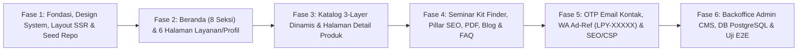

# Roadmap Implementasi, Pengujian & Quality Gates — Liebe Pyrus B2B

**Versi Dokumen:** 1.0
**Tanggal:** 25 November 2026
**Mengacu ke:** [01-PRD.md](01-PRD.md), [prompts/01-PHASE-PROMPTS.md](../prompts/01-PHASE-PROMPTS.md)

Dokumen ini menjadi panduan eksekusi bertahap dan daftar periksa jaminan kualitas (*Quality Assurance*) dari inisialisasi kode hingga siap rilis produksi.

---

## 1. Peta Jalan 6 Fase Pembangunan

---

## 2. Daftar Periksa Tugas per Fase (*Deliverables Checklist*)

### Fase 1 — Fondasi Proyek, Sistem Desain & Data Layer
- [ ] Setup Next.js App Router + TypeScript `strict` + Tailwind CSS v4 + Zod + Drizzle + Vitest.
- [ ] Konfigurasi font lokal `.woff2` (`Plus Jakarta Sans` & `DM Sans`) dan variabel tema **Liebe Pyrus** di `globals.css`.
- [ ] Definisi 19 tabel Drizzle PostgreSQL di `src/server/db/schema.ts`.
- [ ] Penyusunan *Seed Dataset* lengkap (`≥ 4` kategori, `18` subkategori, grup label filter Layer 3, `≥ 24` produk ber-SKU `LP-*`, `≥ 8` paket seminar kit, `≥ 12` item portofolio, `≥ 4` katalog PDF, `≥ 4` artikel blog, `≥ 20` FAQ).
- [ ] Implementasi *Dual-Mode Repository* (`DATA_SOURCE=seed | database`).
- [ ] Komponen global SSR `Header` (dropdown delay + drawer mobile) & `Footer` (`Schema.org/LocalBusiness`).

### Fase 2 — Beranda & Halaman Kredibilitas Layanan In-House
- [ ] `/` — Beranda lengkap 8 seksi konversi berurutan + JSON-LD `@graph`.
- [ ] `/logo-details` — 6 teknik cetak logo, mesin in-house, alur 5 langkah, FAQ cetak.
- [ ] `/custom-design` — 4 bantuan desain gratis, syarat file Vector vs Raster 300 DPI, alur mockup.
- [ ] `/kualitas` — 4 tahap QC satu per satu, standar uji lab SUS 304, klaim garansi elektronik 1 tahun.
- [ ] `/pengiriman` — Opsi pengemasan (`#pengemasan`), pengiriman nasional (`#pengiriman`), & *Blind Dropshipping*.
- [ ] `/about-us` — Filosofi brand *Liebe Pyrus*, angka pencapaian, nilai inti, fasilitas operasional.
- [ ] `/portfolio` — Showcase proyek lintas industri dengan tombol *"Minta penawaran serupa →"*.

### Fase 3 — Katalog Produk 3-Layer & Product Detail Page (PDP)
- [ ] Endpoint API publik taksonomi, label filter subkategori, dan pencarian/paginasi produk.
- [ ] Rute SSR & UI interaktif `/product-catalog`, `/product-catalog/[categorySlug]`, dan `/product-catalog/[categorySlug]/[subcategorySlug]`.
- [ ] Sinkronisasi URL History API, chip filter aktif, `Reset Semua`, laci filter mobile, dan paginasi 16 item/halaman.
- [ ] Rute `/product/[slug]` dengan breadcrumb, galeri & pemilih warna, informasi SKU `LP-*`, seksi teknik cetak kompatibel, tabel spesifikasi B2B, sticky bar WA mobile, produk serupa, dan skema `Product` JSON-LD.

### Fase 4 — Paket Kurasi Acara, Pillar SEO, Katalog PDF, Blog, FAQ & Legal
- [ ] `/seminar-kit` — Komponen eksplorasi item interaktif + mesin filter 4 dimensi (*Budget, Jumlah Item, Acara, Packaging*).
- [ ] 4 Pillar Landing Pages: `/souvenir-kantor-premium`, `/souvenir-payung`, `/souvenir-notebook-custom`, `/powerbank-custom`.
- [ ] `/download-katalog` + `GET /api/public/catalog-pdfs`.
- [ ] `/blog` & `/blog/[slug]` dengan `Article` JSON-LD dan rekomendasi produk terkait.
- [ ] `/faq` dengan pengelompokan topik + `FAQPage` JSON-LD, `/privacy`, dan `/legal#terms`.

### Fase 5 — Mesin Konversi, Keamanan OTP, Atribusi WA & Technical SEO
- [ ] Endpoint `POST /api/public/contact/otp/request`, `/verify`, dan `/send` dengan hash OTP, *rate-limit*, dan *cooldown* 60 detik.
- [ ] Modal OTP di `/contact` + logika pembatalan otomatis bila pengguna mengubah field email.
- [ ] Endpoint `POST /api/public/wa-ref` + client tracker parameter iklan (`gclid`/`gbraid`/`wbraid`/`utm_*`) + injeksi otomatis `(Ref: LPY-XXXXX)` ke seluruh tautan WhatsApp.
- [ ] Pemuatan skrip `gtag.js` *eager* + `GTM/GA4` *deferred*, generator `/sitemap.xml` & `/robots.txt`, serta HTTP Security Headers (`CSP`, `HSTS`, `nosniff`, `SAMEORIGIN`).

### Fase 6 — Backoffice Admin CMS (`/admin`) & Pengujian Akhir
- [ ] Login sesi `HttpOnly` (`/admin/login`) + guard server di semua `/api/admin/*`.
- [ ] Dashboard metrik, CRUD Kategori/Subkategori/Label Filter, CRUD Produk & SKU, CRUD Seminar Kit, Portofolio, Katalog PDF, Blog, dan FAQ.
- [ ] Inbox Leads RFQ (`/admin/inquiries`), Log & Ekspor CSV Atribusi WA (`/admin/wa-refs`), Pengaturan Situs (`/admin/settings`), dan pencatatan `audit_logs`.
- [ ] Skrip migrasi & pengisian awal database PostgreSQL (`db:migrate`, `db:seed`) + rangkaian pengujian otomatis penuh.

---

## 3. Matriks Pengujian Otomatis Wajib

### 3.1 Unit & Integration Tests (`Vitest`)

| Modul yang Diuji | Skenario Pengujian Wajib |
| --- | --- |
| **Generator & Formatter WhatsApp** | (1) Sapaan otomatis tepat sesuai prefix URL, (2) Tidak ada karakter rusak/emoji 4-byte, (3) Kode `(Ref: LPY-XXXXX)` disisipkan hanya bila cookie valid tersedia dan tidak pernah tertulis ganda |
| **Mesin Filter Katalog 3-Layer** | (1) Filter kategori menyaring grup subkategori yang benar, (2) Filter Layer 3 terkunci sebelum subkategori dipilih, (3) Kombinasi multi-label + pencarian SKU menghasilkan himpunan produk dan jumlah halaman paginasi yang akurat |
| **Filter Seminar Kit 4 Dimensi** | Penyaringan simultan *Budget + Jumlah Item + Jenis Acara + Packaging* serta fungsi reset bekerja konsisten |
| **Layanan OTP Kontak** | (1) Hash OTP cocok saat benar dan ditolak saat salah/kedaluwarsa, (2) Cooldown 60 detik menolak spam request dini, (3) Pengiriman `/send` tanpa verifikasi OTP email yang cocok wajib ditolak `403`/`400` |
| **Guard API Admin** | Seluruh endpoint `/api/admin/*` wajib mengembalikan `401` ketika dipanggil tanpa cookie sesi valid |

### 3.2 End-to-End Browser Tests (`Playwright`)

1. **Alur Pembeli Korporat (Katalog → PDP → WhatsApp):** Buka `/product-catalog` → pilih `Gadget` → pilih `Powerbank` → centang filter `10.000 mAh` → buka detail produk → ganti warna ke `Putih` → pastikan `href` tombol WhatsApp memuat nama produk, kode SKU `LP-*`, dan warna `Putih`.
2. **Alur Atribusi Iklan Google Ads:** Buka `/souvenir-payung?gclid=TEST12345&utm_campaign=payung_b2b` → pastikan cookie `lp_ref` berpola `LPY-XXXXX` terbentuk → pastikan tombol WhatsApp di halaman tersebut memuat sapaan khusus payung beserta `(Ref: LPY-XXXXX)`.
3. **Alur Formulir Kontak OTP:** Isi form `/contact` → minta OTP → pastikan modal muncul dan tombol kirim ulang terkunci hitung mundur → ubah alamat email di belakang modal dan pastikan sesi OTP dibatalkan sesuai aturan → minta ulang & masukkan OTP valid → pastikan pesan tersimpan sukses.
4. **Alur Admin CMS:** Login di `/admin/login` → tambah produk baru atau ubah status *inquiry* menjadi `Dihubungi` → verifikasi perubahan tersimpan dan muncul di tampilan yang sesuai.

---

## 4. Gerbang Kualitas Akhir (*Release Readiness Gate*)

Sebelum melakukan rilis ke produksi, seluruh butir berikut harus bernilai **LULUS**:

1. `npm run typecheck` lulus `0 error`.
2. `npm run lint` lulus `0 error`.
3. `npm test` (Vitest) dan `npx playwright test` lulus `100%`.
4. `npm run build` selesai bersih tanpa peringatan hidrasi SSR.
5. Pemeriksaan responsif pada lebar `375px` (iPhone SE/Android), `768px` (Tablet), dan `1440px` (Desktop): tidak ada teks terpotong, tabel meluber keluar layar, atau tombol sentuh `< 44px`.
6. Audit Lighthouse pada halaman utama (`/`, `/product-catalog`, `/product/[slug]`, `/seminar-kit`):
   - **Performance:** `≥ 90` (Mobile) / `≥ 95` (Desktop)
   - **Accessibility:** `≥ 95`
   - **Best Practices:** `≥ 95`
   - **SEO:** `100`
